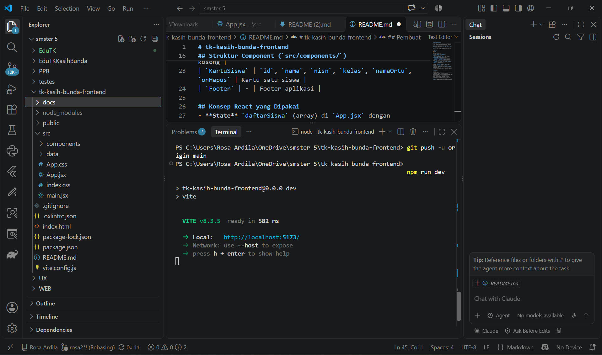
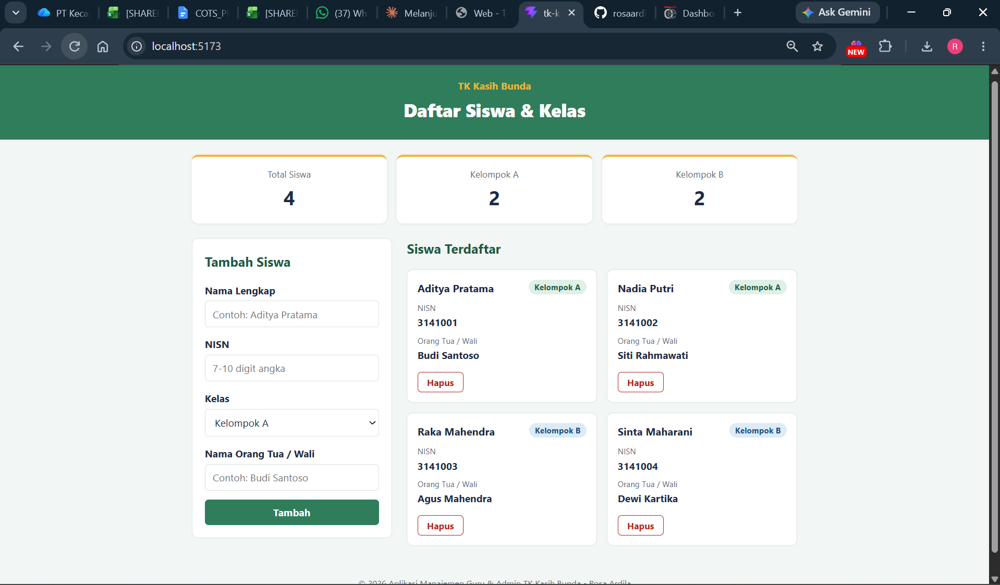
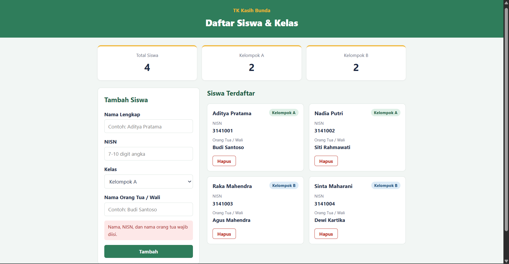
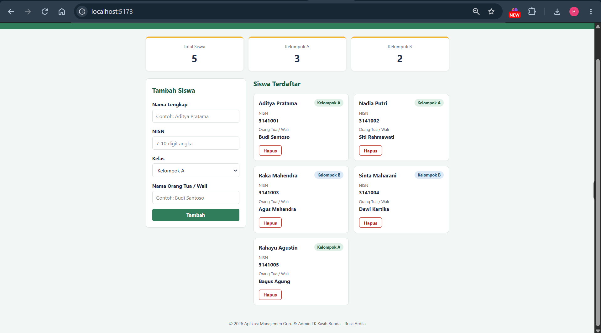
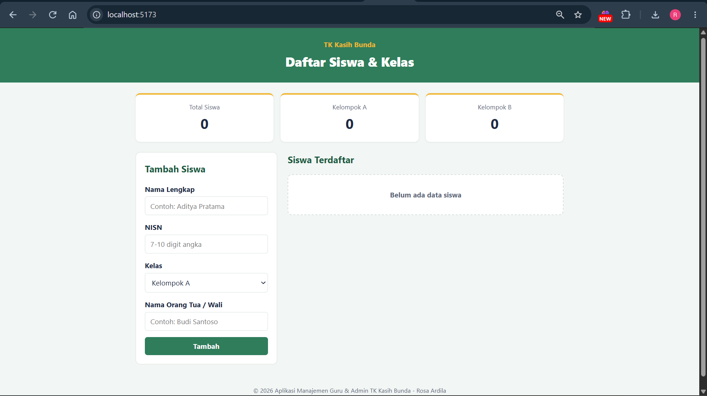
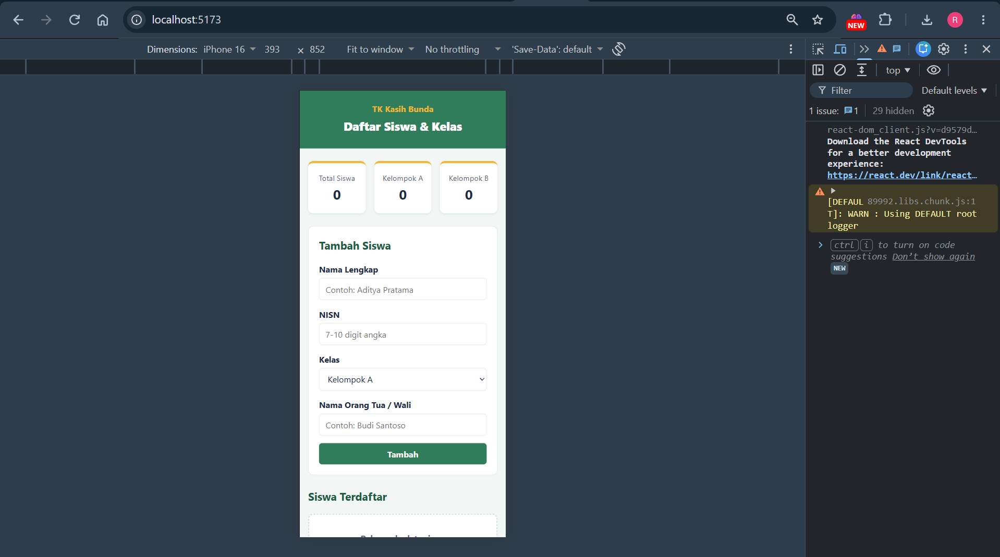

# tk-kasih-bunda-frontend

Frontend React (Vite) untuk **Aplikasi Manajemen Guru & Admin TK Kasih Bunda**, melanjutkan studi kasus dari tugas HTML, CSS, Bootstrap, dan JavaScript/jQuery sebelumnya.

**Entitas data utama:** Siswa (`id`, `nama`, `nisn`, `kelas`, `namaOrtu`).

Project ini adalah kerangka awal aplikasi fullstack. Pada pekan 11 frontend akan disambungkan ke backend/API.

## Menjalankan
```bash
npm install
npm run dev
```
Buka http://localhost:5173

## Struktur Component (`src/components/`)
| Component | Props | Fungsi |
|---|---|---|
| `Header` | `namaSekolah`, `judul` | Judul aplikasi |
| `RingkasanData` | `total`, `jumlahKelompokA`, `jumlahKelompokB` | Ringkasan jumlah siswa |
| `FormTambahSiswa` | `onTambah` | Form controlled untuk menambah siswa + pesan error |
| `DaftarSiswa` | `daftarSiswa`, `onHapus` | Render list dengan `.map()`, menampilkan "Belum ada data siswa" jika kosong |
| `KartuSiswa` | `id`, `nama`, `nisn`, `kelas`, `namaOrtu`, `onHapus` | Kartu satu siswa |
| `Footer` | - | Footer aplikasi |

## Konsep React yang Dipakai
- **State** `daftarSiswa` (array) di `App.jsx` dengan `useState`.
- **Render list** `.map()` dengan `key` unik (`id`).
- **Controlled component** pada form (`value` + `onChange`).
- **Conditional rendering** untuk teks "Belum ada data siswa" dan pesan error form.
- **Props** untuk komunikasi data dan fungsi antar component (`onTambah`, `onHapus`).

## Screenshot
| Tahap | Gambar |
|---|---|
| Instalasi berhasil (localhost:5173) |  |
| Tampilan awal aplikasi |  |
| Error validasi form |  |
| Setelah menambah siswa |  |
| Daftar kosong ("Belum ada data siswa") |  |
| Tampilan mobile |  |

## Pembuat
Rosa Ardila — S1 Rekayasa Perangkat Lunak, Universitas Telkom
