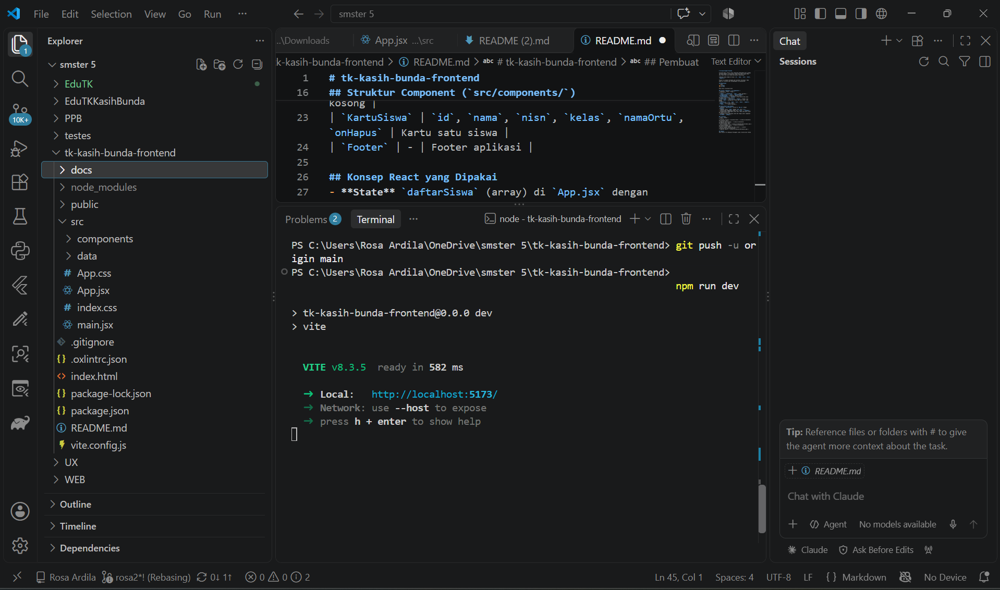
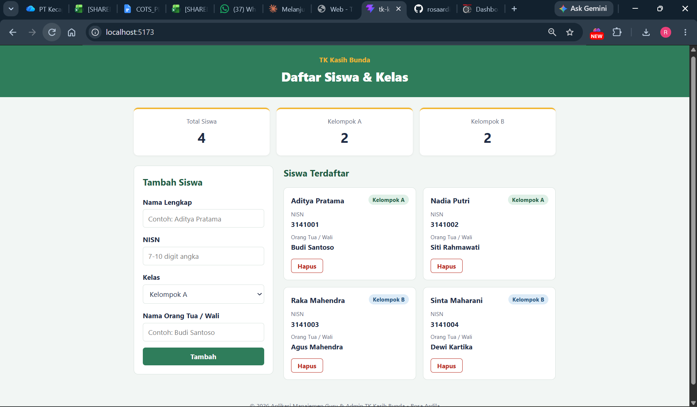
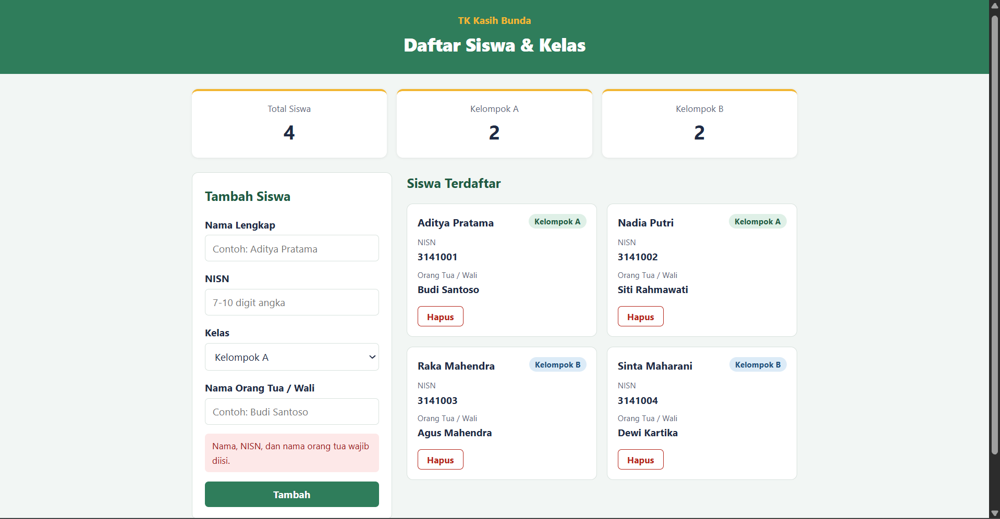
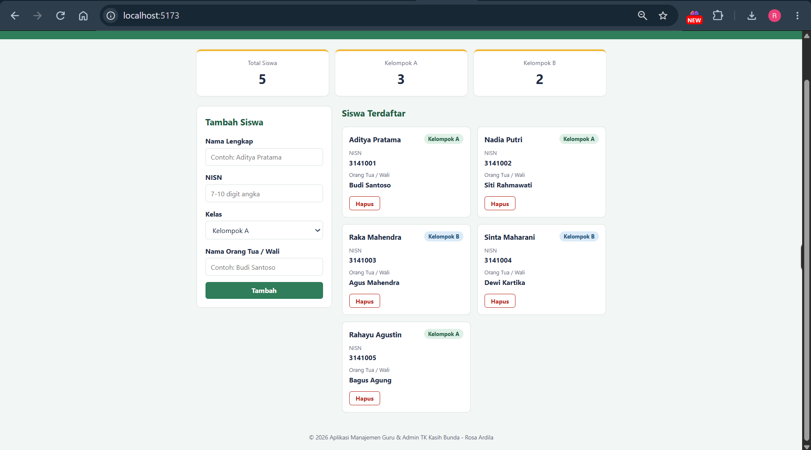
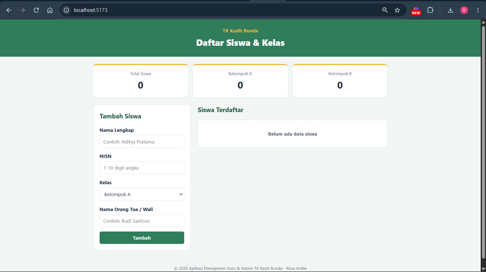
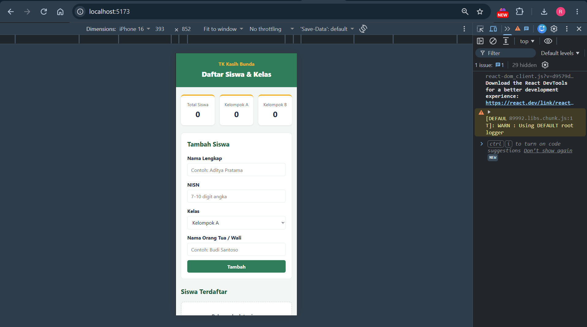
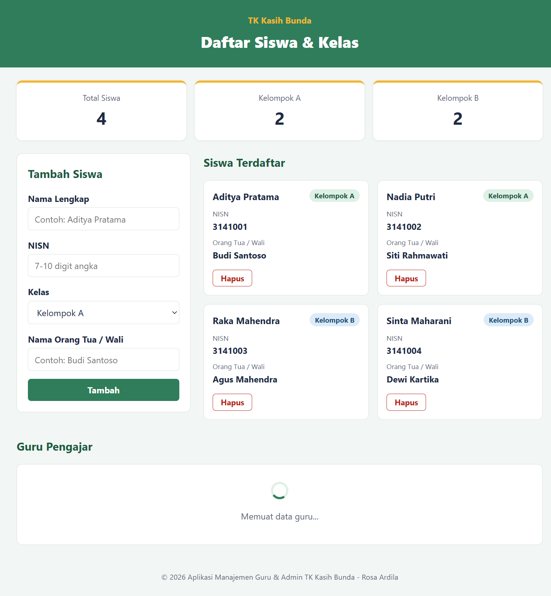
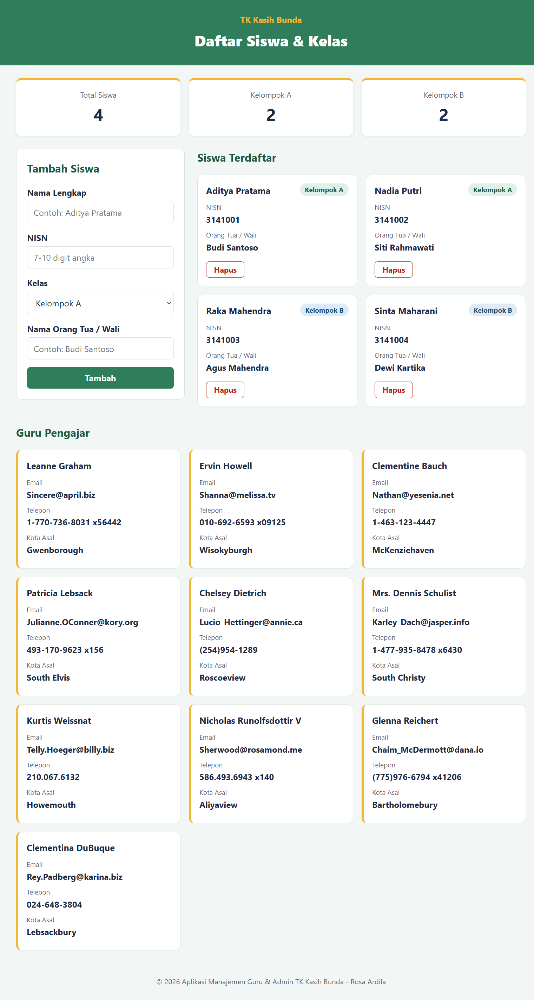
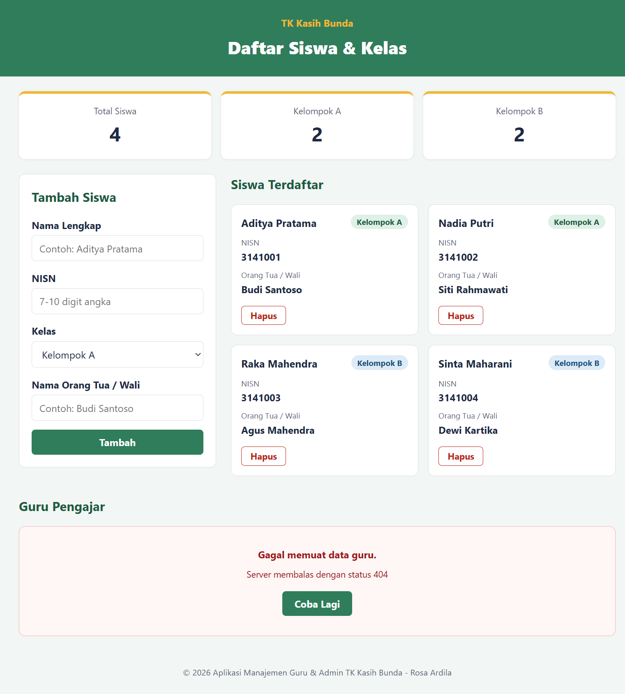

# tk-kasih-bunda-frontend

Frontend React (Vite) untuk **Aplikasi Manajemen Guru & Admin TK Kasih Bunda**, melanjutkan studi kasus dari tugas HTML, CSS, Bootstrap, dan JavaScript/jQuery sebelumnya.

**Entitas data utama:** Siswa (`id`, `nama`, `nisn`, `kelas`, `namaOrtu`).

Project ini adalah kerangka awal aplikasi fullstack. Pada pekan 11 frontend akan disambungkan ke backend/API.

## Menjalankan
```bash
npm install
npm run dev
```
Buka http://localhost:5173

## Struktur Component (`src/components/`)
| Component | Props | Fungsi |
|---|---|---|
| `Header` | `namaSekolah`, `judul` | Judul aplikasi |
| `RingkasanData` | `total`, `jumlahKelompokA`, `jumlahKelompokB` | Ringkasan jumlah siswa |
| `FormTambahSiswa` | `onTambah` | Form controlled untuk menambah siswa + pesan error |
| `DaftarSiswa` | `daftarSiswa`, `onHapus` | Render list dengan `.map()`, menampilkan "Belum ada data siswa" jika kosong |
| `KartuSiswa` | `id`, `nama`, `nisn`, `kelas`, `namaOrtu`, `onHapus` | Kartu satu siswa |
| `Footer` | - | Footer aplikasi |

## Konsep React yang Dipakai
- **State** `daftarSiswa` (array) di `App.jsx` dengan `useState`.
- **Render list** `.map()` dengan `key` unik (`id`).
- **Controlled component** pada form (`value` + `onChange`).
- **Conditional rendering** untuk teks "Belum ada data siswa" dan pesan error form.
- **Props** untuk komunikasi data dan fungsi antar component (`onTambah`, `onHapus`).

## Screenshot
| Tahap | Gambar |
|---|---|
| Instalasi berhasil (localhost:5173) |  |
| Tampilan awal aplikasi |  |
| Error validasi form |  |
| Setelah menambah siswa |  |
| Daftar kosong ("Belum ada data siswa") |  |
| Tampilan mobile |  |


---

## Tugas 7: Ajax dan Konsumsi API (Mock)

Aplikasi sekarang mengambil data **Guru Pengajar** dari API mock secara asinkron memakai `fetch()`, lengkap dengan kondisi **loading**, **success**, dan **error**.

### Endpoint yang dipakai dan alasannya
`GET https://jsonplaceholder.typicode.com/users`

Saya memilih JSONPlaceholder karena gratis, tanpa pendaftaran, dan mendukung CORS sehingga bisa dipanggil langsung dari browser. Endpoint `/users` mengembalikan daftar orang lengkap dengan nama, email, telepon, dan kota. Bentuk datanya cocok untuk daftar guru pengajar di TK Kasih Bunda, jadi saya memetakan `name`, `email`, `phone`, dan `address.city` menjadi `nama`, `email`, `telepon`, dan `kota`. Datanya hanya dummy, dan pada pekan 11 sumbernya akan diganti dengan API backend milik sendiri.

### Cara menerapkan pola loading / success / error
- **`ambilDataGuru()`** (`App.jsx`): fungsi `async` yang memanggil `fetch(URL_GURU)`. Jika `respons.ok` bernilai false, fungsi melempar `Error` berisi kode status. Jika berhasil, data diubah dengan `.map()` menjadi array guru.
- **State `statusGuru`** (`App.jsx`): berisi `'loading'`, `'success'`, atau `'error'`. Nilai awalnya `'loading'`, sehingga indikator muncul sejak halaman dibuka. Ada juga state `daftarGuru` untuk data dan `pesanErrorGuru` untuk teks error.
- **`muatDataGuru()`** (`App.jsx`): memanggil `ambilDataGuru()`. Jika `.then()` berjalan, data disimpan dan status menjadi `'success'`. Jika `.catch()` berjalan (jaringan putus atau status gagal), pesan error disimpan dan status menjadi `'error'`. Fungsi ini dipanggil sekali lewat `useEffect` saat halaman pertama dimuat.
- **`DaftarGuru`** (`components/DaftarGuru.jsx`): memilih tampilan sesuai `status` dengan conditional rendering: spinner dan teks "Memuat data guru..." saat loading, kotak merah berisi pesan error saat gagal, dan daftar kartu saat sukses. Daftar dirender dengan `.map()` dan `key={guru.id}` ke component `KartuGuru`.
- **Interaksi "Coba Lagi":** tombol ini hanya muncul saat status `'error'` dan memanggil **`cobaLagiGuru()`**, yang mengembalikan status ke `'loading'` lalu menjalankan `muatDataGuru()` lagi.

### Screenshot
| Kondisi | Gambar |
|---|---|
| Loading |  |
| Success |  |
| Error (URL sengaja diubah salah sementara) |  |


## Pembuat
Rosa Ardila — S1 Rekayasa Perangkat Lunak, Universitas Telkom
